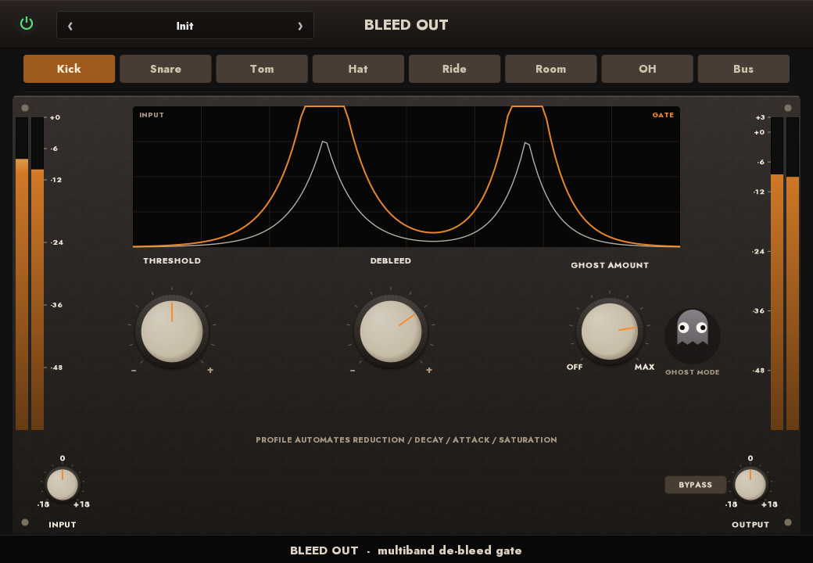
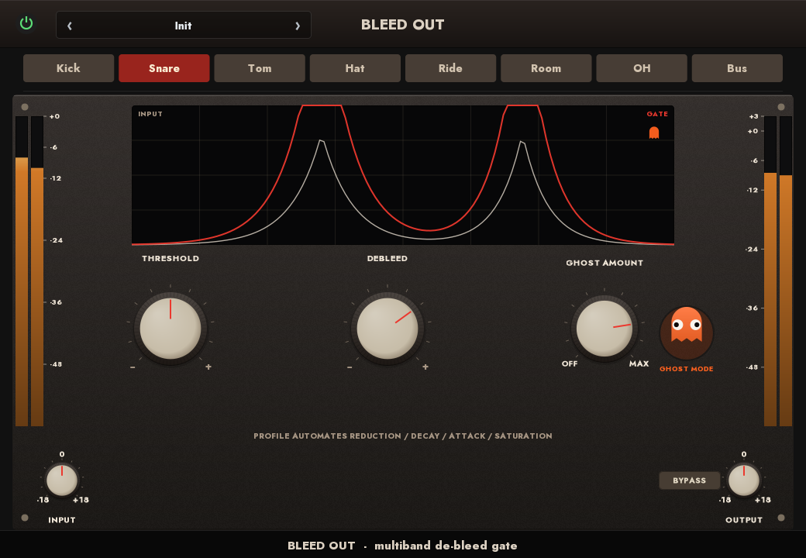

# Bleed Out

**Version 0.1.0** · GPL-3.0-or-later

A multiband de-bleed gate for drums, built in the same visual language as Comp
Suite and the rest of the Suite series. It removes hi-hat and cymbal bleed while
keeping the attack, body and tone of the drum.

This is the working prototype for local testing.



## Signal flow

```text
Input
  → 3-band detector (body + cymbal bands)
  → main gate
  → high-band de-bleed sidechain (driven by the drum body)
  → multiband ADAA saturation
  → multiband EQ
  → output
```

## Three controls, one job

The drum profile does the rest. There are only three things to set:

1. **Threshold** — raise it until the gate opens on every real hit and stays
   closed on the bleed.
2. **DeBleed** — raise it until the hi-hat/cymbal wash disappears between hits.
3. **Ghost** — turn the ghost icon on and set the amount so quiet ghost notes
   survive.

Reduction, decay, attack, hold, hysteresis, crossover points, multiband tone and
saturation are automated by the selected drum profile. That is deliberate: a
drum gate should not need a second page of knobs to sound good.

### How DeBleed works

The high band (cymbals, hi-hat, snare wires) is gated **from the drum body**,
not from the cymbal wash itself. This is the same idea as the Nolly/FabFilter
Saturn trick and the Black Salt Audio Silencer de-bleeding circuit: the low/mid
body detector opens the high band for the attack, then the high band closes
quickly while the body has decayed. DeBleed sets how far down that high band goes
between hits.

The de-bleed sidechain has its own short hold/release (10/35 ms on Snare), so it
does not ride the main gate's long tail. At DeBleed 100 the high band is 48 dB
down between hits; at DeBleed 0 it is untouched.

Measured on a synthetic snare (200 Hz body, continuous 8 kHz bleed), DeBleed
0 → 100:

| Signal | DeBleed 0 | DeBleed 100 |
|---|---:|---:|
| Bleed between hits | −30.8 dB | −67.3 dB |
| Snare body at the hit | −11.0 dB | −11.0 dB |
| High-frequency attack at the hit | −30.4 dB | −30.4 dB |

That is a 36 dB cut in bleed with the body and attack unchanged. The test is
part of `bleed_dsp`.

## Drum profiles

Kick, Snare, Tom, Hat, Ride, Room, OH, Bus. Selecting a profile changes the
detector weights, crossovers and the automated gate/tone/saturation settings.
It is not a full preset: your Threshold and DeBleed stay where you put them
until you pick a new profile, which loads its sensible starting values.

## Ghost note mode



Ghost notes are quiet snare hits that a normal gate would remove. Bleed Out
adds a second, lower-threshold transient detector and a dedicated ghost
envelope. It opens both the main gate and the de-bleed high band, so a ghost
note keeps its body and its top end instead of sounding dull.

- The **ghost icon** toggles ghost note mode. It is a Pac-Man-style ghost, as
  required by metal law.
- **Ghost amount** is a normal automatable parameter and the knob next to the
  icon.
- **MIDI CC (default 74)** sets the ghost amount.
- **MIDI note-on (default 38)** sets the ghost amount from velocity and opens a
  short ghost window, so a MIDI performance can add ghost notes.
- The scope shows a small ghost when the ghost window is open.

Host automation and MIDI both work; the parameter is saved with the session.

## Build

Requires CMake 3.16+, a C++17 compiler, Cairo, FreeType, X11 and the LV2
development headers.

```sh
git submodule update --init --recursive
cmake -S . -B build -DCMAKE_BUILD_TYPE=Release
cmake --build build -j
ctest --test-dir build --output-on-failure
```

Install for the current user:

```sh
cmake -S . -B build \
  -DCLAP_DIR="$HOME/.clap" \
  -DLV2_DIR="$HOME/.lv2"
cmake --build build -j
cmake --install build
```

## Status

0.1.0 is a working prototype: three-knob de-bleed gate, drum profiles, ghost-note
mode, MIDI note/CC control, CLAP and LV2.

Known prototype limits:

- The LV2 UI scope is flat (the CLAP UI has the live scope). The LV2 meters and
  controls work.
- Lookahead is fixed at 2 ms so switching drum profiles never changes plugin
  delay.
- Learn/Listen and the full Drum Suite Sample/EQ/Comp/Drive/Clip/Limit pages
  are not part of this standalone prototype.

## Licence

GPL-3.0-or-later. See `THIRD_PARTY_NOTICES.md`.
